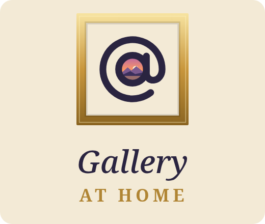
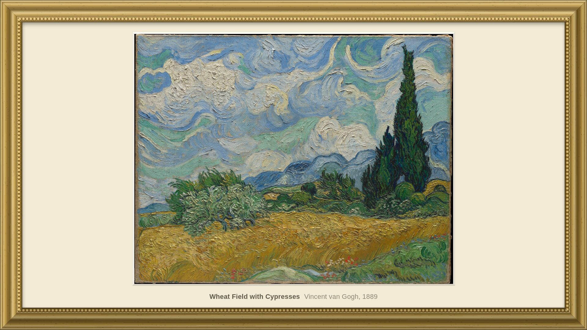
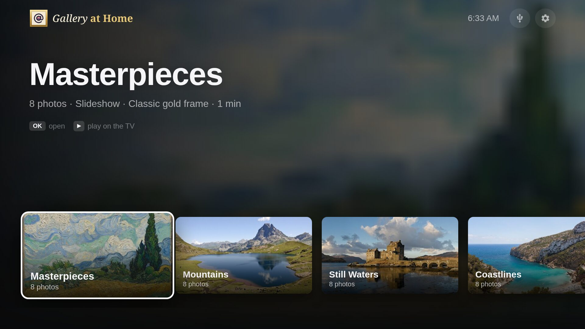
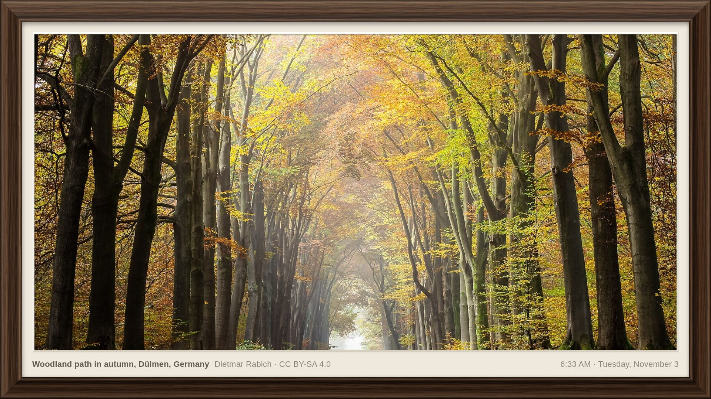
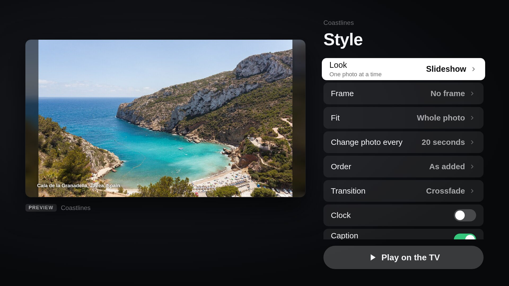
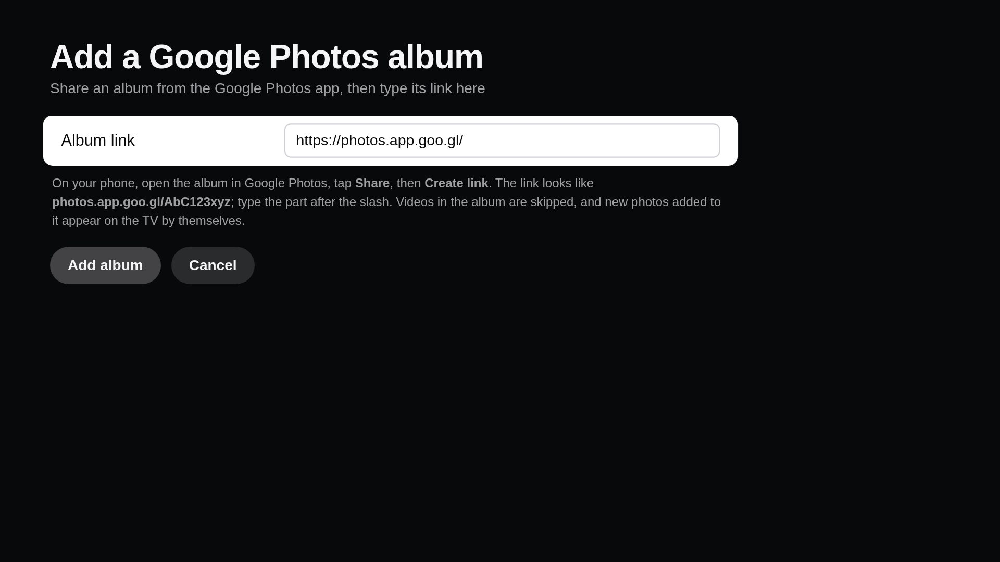

<p align="center"></p>

# Gallery at Home

A photo gallery for Samsung TVs: your photos and the included collections, framed, on the wall.

<p align="center">
  
  
</p>

A Tizen TV app for building photo collections and playing them on the TV,
driven entirely with the remote. No server or phone app is needed.

- **Sources:** Google Photos shared albums (type the album's share link; the
  collection stays in sync with the album), USB drives plugged into the TV,
  NAS/network shares
  (WebDAV or plain web-server folder listings) and web links (direct photo
  URLs, pages, or text/JSON lists of URLs).
- **Collections:** pick photos one by one or whole folders (subfolders
  included) from any mix of sources.
- **Now showing:** whatever you play last stays pinned: one photo ("Show
  this photo", or Red on a photo) or a whole collection (Play). Opening the
  app goes straight to it, the menus return to it after a few idle minutes
  (Settings), and it stays until you play something else. Samsung doesn't let
  apps replace the TV's own screensaver or start by themselves on consumer
  TVs, so the app itself plays that role while it's open; it keeps the TV's
  screensaver off while showing.
- **Frames:** Gallery white, Modern black, Natural oak, Dark walnut, Classic
  gold or Floating. The whole screen becomes the picture frame: moulding on
  the TV's edges, a mat inside, and an opening cut to each photo's shape
  ("Whole photo") or, by default, an opening close to the screen's shape
  that the photo fills, cropping at most a quarter of it ("Fill the frame").
  The frame stays put while photos change; the caption and clock sit on the
  mat like a gallery label. Available for Slideshow and Memories.
- **Play modes:**

  | Mode | What it does |
  |---|---|
  | Slideshow | One photo at a time; crossfade, slide, zoom or cut |
  | Ken Burns | Slow pan-and-zoom across each photo |
  | Mosaic | A 7-tile wall; one tile changes at a time, portraits in tall tiles |
  | Duo | Pairs portrait photos side by side |
  | Memories | Photos taken around today's date in past years ("7 years ago") |

  Options: interval, order (as added, shuffle, date taken, name), framing
  (whole photo on a colour-matched backdrop, or fill), clock, caption, and a
  sleep timer. During playback: ◀ ▶ previous/next, OK pause, Blue changes
  mode, Back exits. The TV's screensaver is held off while playing.

<p align="center">
  
  
  
</p>

Target: 2020+ Samsung TVs (Tizen 5.5, Chromium 69 web engine). The bundle is
compiled down for that engine, and the CSS avoids newer features (flex `gap`,
`inset`, unguarded `aspect-ratio`). Photo rotation is applied by the app,
because Chromium 69 ignores the EXIF orientation tag.

## Development

```sh
npm install
node dev/make-samples.mjs   # once: builds dev/sample-usb, a fake USB drive
npm run dev                 # http://localhost:5173
```

Keyboard stand-ins for the remote: arrows, Enter = OK, Esc/Backspace =
Back, Space = play/pause, `1` `2` `3` `4` = Red/Green/Yellow/Blue, `,` `.` =
previous/next.

The dev server fakes `tizen.filesystem` with `dev/sample-usb` and proxies
cross-origin requests. On the TV, `config.xml` grants network access
directly, so no proxy is used there.

`npm run typecheck` checks the types; `npm run build` writes `dist/`.

## Running on the emulator or the TV

Needs Tizen Studio CLI in `~/tizen-studio` (TV extensions and certificate
add-on installed).

```sh
scripts/tv.sh connect <tv-ip>        # the TV, in Developer Mode
scripts/tv.sh deploy <tv-ip>:26101   # build, sign, install and launch
```

Some TVs refuse to update the app in place now and then ("download
failed"). `deploy` then saves the app's data (collections, sources,
settings) through the TV's debug connection, uninstalls, installs afresh and
restores it (`scripts/tv-data.mjs`). `scripts/tv.sh reinstall` does the same
on purpose, and `backup` / `restore` save and put back the data on their
own. Backups go to `.tv-backups/` (git-ignored: they include album links and
network-share passwords).

TVs and the TV emulator only install apps signed with a **Samsung**
certificate. Create one in Tizen Certificate Manager (+ → Samsung → TV) as a
profile named `gallery-at-home`, adding each device's DUID
(`sdb -s <device> shell 0 getduid`); `scripts/tv.sh` signs with it when it
exists, and otherwise with a self-made profile `gallery-at-home-dev` (author key under
`.sign/`, git-ignored), which Samsung devices reject.

**TV Developer Mode:** Apps → type `12345` with the remote → Developer mode
On, Host PC IP = this computer's IP → restart the TV.

**Emulator:** `QT_QPA_PLATFORM=xcb ~/tizen-studio/tools/emulator/bin/em-cli
launch -n T-samsung-10.0-x86_64`, then `scripts/tv.sh deploy emulator-26101`.
The emulator reaches this computer at `10.0.2.2` (e.g. a test share from
`python3 -m http.server 8099 --directory dev/sample-usb`, added as the
network share `http://10.0.2.2:8099/`). It has no USB drives.

**Inspecting the running app:** `sdb shell 0 debug GalleryAtH.GalleryAtHome`
relaunches it with a DevTools port; `sdb forward tcp:9222 tcp:<port>` and open
`http://localhost:9222` in Chromium. Remote keys can be sent through the
DevTools protocol (`Input.dispatchKeyEvent` with the Tizen key codes, e.g.
10009 for Back, 403–406 for the colour keys). The DevTools session ends the
first time a client disconnects, so keep one connection open.

## Included collections

Seven themed collections come with the app (Masterpieces, Mountains, Still
Waters, Coastlines, Forests & Waterfalls, After Dark, Space): 56 openly
licensed photos and public-domain paintings, about 34 MB in the package. They
are added once on first run; deleting one sticks, and Settings → Included
collections restores them. Settings → Photo credits lists every author and
licence; [CREDITS.md](CREDITS.md) has the full list with links.

To change them: `node scripts/samples/candidates.mjs <dir>` (Wikimedia Commons
featured pictures) and `node scripts/samples/met.mjs <dir>` (The Met Open
Access) download previews to choose from; list the choices in
`scripts/samples/picks.json`, then `node scripts/samples/build.mjs` writes
`assets/samples/`, `src/samples/manifest.json` and `CREDITS.md`. Only
public-domain, CC0, CC BY and CC BY-SA images are accepted.

## Google Photos shared albums

Google offers no API for reading a shared album from its link, so the app
reads the album's public page the way a browser does
(`src/sources/gphotos-read.ts`): the first 300 items are embedded in the page,
the rest come from the page's own data endpoint, and videos are skipped.
Reading runs in a Web Worker (`album-worker.ts`) so the TV's screen never
freezes for it. Album collections re-read the album in the background when
opened (after 30 minutes) and every 30 minutes while playing.

Newer browser engines (2021+ TVs, the Tizen 10 emulator) label app requests
`Sec-Fetch-Site: cross-site`, which Google refuses. There the album page is
fetched with Tizen's download manager instead (`fetch-text.ts`), which can't
make the POST requests later pages need, so those TVs read an album's first
300 items. Google can change the page format at any time; the collection then
keeps the photos it last read.

## Layout

```
src/
  app.tsx            screen stack, remote key handling, Back behaviour
  nav/               spatial (arrow-key) focus navigation, router
  platform/          Tizen APIs: remote keys, screensaver, USB filesystem
  sources/           Google Photos, USB, network, web adapters + EXIF reader
  samples/           the included collections (manifest; photos in assets/)
  store/             collections, sources, settings (localStorage on the TV)
  screens/           home, collection, browse, play options, source setup
  player/            play queue, preloading, slide engine, mosaic
  ui/                widgets, dialogs/toasts, upright photo layout
assets/              included photos (samples/) and logo images (brand/)
tizen/config.xml     app manifest (privileges, network access)
dev/                 dev server, sample-photo generator
scripts/             build, package/deploy to TV; samples/ and brand/ build
                     the included collections and the logo
```

## Licence

Gallery at Home is source-available under the
[PolyForm Strict License 1.0.0](LICENSE): free to use for any noncommercial
purpose, but it may not be redistributed or modified. The included photos,
test photos and screenshots keep their own licences; see
[NOTICE.md](NOTICE.md) and [CREDITS.md](CREDITS.md).
